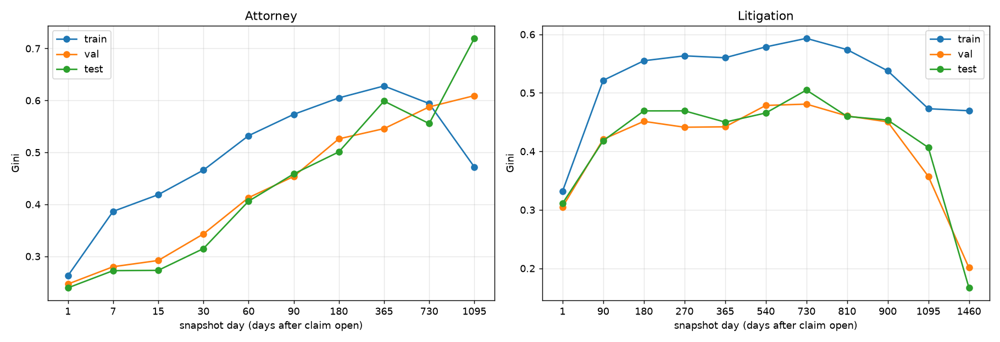
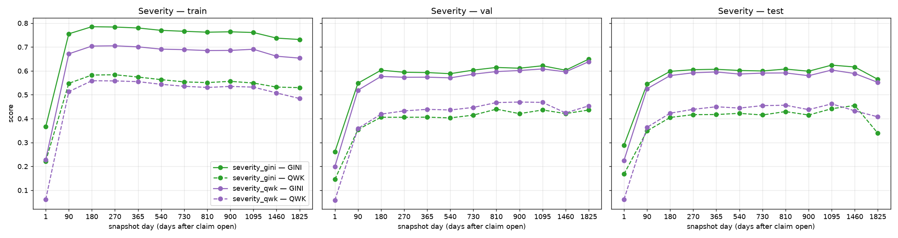
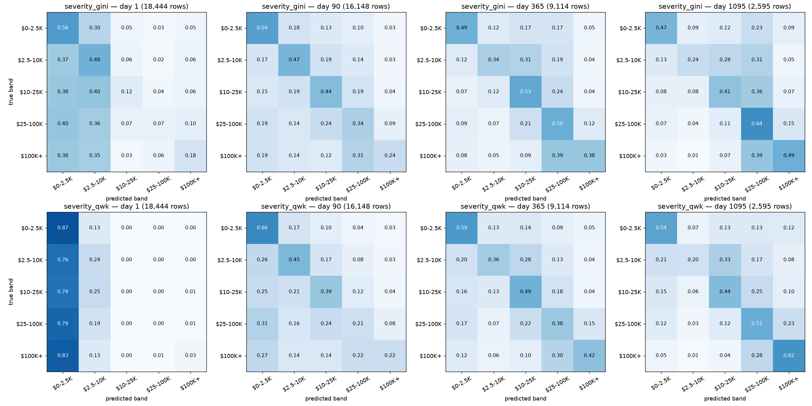

# 2.5 Results and visualization

| File | Content |
|---|---|
| `2.5.1-Results-Visualization.ipynb` | (1) Gini by snapshot day (train / val / test) for attorney and litigation; (2) severity Gini and QWK by snapshot day for both severity models, one panel per split; (3) severity confusion matrices at cutoff days 1, 90, 365 and 1,095; (4) attorney and litigation decile tables, and (5) severity decile tables plus the Gini at each band threshold (band 4 vs rest, 3–4 vs rest, 2–4 vs rest, 1–4 vs band 0). Sections 4 and 5 have buttons for the model and rows shown (test / validation) and a slider for the cutoff day. |
| `figures/` | The notebook's figures as PNGs. |
| `predictions/` *(git-ignored)* | The best model's prediction for every row of each study, which is the notebook's input. These files contain real claim numbers, so they are not in the repository. |

## Final scores

| Study | Best trial | Train | Val | Holdout | Holdout, last snapshot | Holdout QWK |
|---|---|---|---|---|---|---|
| `attorney` | 42 | 0.426 | 0.334 | 0.326 | 0.407 | – |
| `litigation` | 24 | 0.554 | 0.479 | 0.488 | 0.697 | – |
| `severity_gini` | 32 | 0.735 | 0.563 | 0.569 | 0.752 | 0.402 |
| `severity_qwk` | 23 | 0.651 | 0.537 | 0.546 | 0.730 | 0.430 |

All columns except the last are Gini. Severity Gini is the ordinal, support-weighted Gini.

## Decile tables (sections 4 and 5)

For the chosen cutoff day, that day's validation rows are sorted by score and split into 10 equal-size groups (D1 =
highest). Test rows of the same day are placed into those validation score ranges. The score is the predicted
probability for attorney and litigation, and the expected band Σ k·P(band k) for severity. Every table is precomputed into the
notebook output, so the buttons and slider work when the saved notebook is opened in Jupyter or VS Code, without
re-running it. GitHub's preview blocks scripts, so there only the day-1 test table shows.

## Figures

**Attorney and Litigation: Gini by snapshot day**

**Severity: Gini and QWK by snapshot day, both models, one panel per split**

**Severity confusion matrices at cutoff days 1, 90, 365 and 1,095** (test; one row of panels per model; each row sums to 1)

