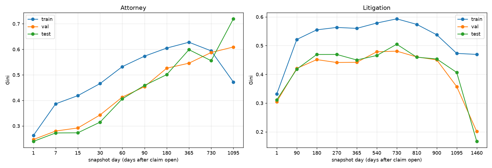
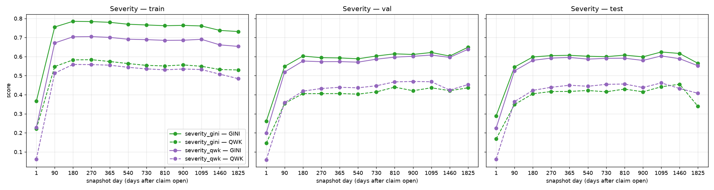

# Strategy A: Note-Embedding Approach

Embed every adjuster note **once** with a pretrained text-embedding model. Then, for every coverage, summarize
the embeddings of the notes written before each day-grid cutoff, and train a neural network to predict
**attorney involvement**, **litigation** and **severity band**.

**Why this approach:** a note's embedding doesn't depend on the target or the cutoff, so 4.65M notes are
embedded once and reused by every model and every snapshot. Eight element-wise summaries (mean, max, min, sum,
max÷min, max−min, first÷last, first−last) capture both where the claim stands now and how it has changed,
without fine-tuning a language model.

```
2.1-DatasetDevelopment  2.1.1 keyword registry + 2.1.2 global claim-level split ──────────────┐
2.2-Embedding           BI_Notes ─2.2.1─▶ 20 JSONL shards ─2.2.2─▶ 1,536-dim vector per note ─┤
2.1-DatasetDevelopment  2.1.3 build_cutoff_dataset: per coverage × cutoff, 8 summaries ◀───────┘
2.3-ModelTraining       CutoffNet + Optuna on SageMaker (4 studies)
2.4-ModelArtifacts      best checkpoints + dataset / split / study manifests
2.5-Results             Gini by day per split, severity Gini + QWK by day, confusion by day, decile tables
```

## Folders, in order

| Step | Folder | What it holds | README |
|---|---|---|---|
| 2.1 | `2.1-DatasetDevelopment/` | `2.1.1-build_keyword_registry.py`, `2.1.2-assign_global_splits.py`, `2.1.3-build_cutoff_dataset.py`: event-keyword flags, the global 70/15/15 claim split, and the per-coverage cutoff datasets | [link](2.1-DatasetDevelopment/README.md) |
| 2.2 | `2.2-Embedding/` | `2.2.1-Note-Preparation.ipynb` (clean and shard the notes), `2.2.2-Embedding-Inference.ipynb` (gte-Qwen2 on a SageMaker endpoint) | [link](2.2-Embedding/README.md) |
| 2.3 | `2.3-ModelTraining/` | `model.py`, `data.py`, `engine.py`, `2.3.2-tune.py`, `2.3.1-launch_sagemaker.py`: the network, data loader, training loop, Optuna search and job launcher | [link](2.3-ModelTraining/README.md) |
| 2.4 | `2.4-ModelArtifacts/` | best checkpoint of each study (`.pt`) and the JSON manifests | [link](2.4-ModelArtifacts/README.md) |
| 2.5 | `2.5-Results/` | `2.5.1-Results-Visualization.ipynb`, `figures/` | [link](2.5-Results/README.md) |

**Run order:** `2.1.1-build_keyword_registry.py` → `2.1.2-assign_global_splits.py` → `2.2.1` → `2.2.2` → `2.1.3-build_cutoff_dataset.py`
→ `2.3.1-launch_sagemaker.py` (once per study) → `2.5.1-Results-Visualization.ipynb`. All paths come from `config.py`.

## Method

1. **Rows.** One row per coverage (`CLM_CVG_PK`) per day-grid cutoff. These are the same rules as
   `../3-ManualFeatureBasedApproach/3.1-Dataset-Development.ipynb`:
   - the boundary is the event date if the event happened, otherwise the close date (for severity, the last
     close date);
   - only notes strictly before the boundary are used;
   - if no note falls on the boundary and the last kept note mentions the event, that note is dropped;
   - cutoffs with no new notes, or with no notes at all, are skipped.
2. **Split.** One global claim-level split, stratified on channel, state, loss year and the three targets
   (seed 42). Every coverage of a claim lands in the same split for every target.
3. **Features.** At each cutoff, 8 element-wise summaries of the eligible notes' 1,536-dim embeddings, giving
   8 × 1,536 values per row.
4. **Network (`CutoffNet`).** One encoder per summary (Linear → LayerNorm → GELU → Dropout), then
   concatenation, a fusion layer, an MLP head, and 1 logit (binary) or 5 logits (severity).
5. **Tuning.** Optuna TPE with a median pruner, 50 trials per study, on one `ml.g5.4xlarge` per study.
   Selection and early stopping use **validation only**. Holdout is reported, never used for selection.
6. **Studies.** `attorney`, `litigation`, `severity_gini` (selected on ordinal Gini) and `severity_qwk`
   (selected on quadratic-weighted kappa).

## Data

| Target | Rows | Coverages | Label | Holdout rows |
|---|---|---|---|---|
| Attorney | 466,090 | 120,502 | 41.1% positive rows | 69,471 |
| Litigation | 388,956 | 129,804 | 16.6% positive rows | 57,519 |
| Severity | 619,029 | 132,737 | band 0–4 | 92,161 |

Claims per split: 81,212 / 17,418 / 17,267 (train / val / holdout).

## Results

| Study | Trials completed | Best trial | Train Gini | Val Gini | Holdout Gini | Holdout, last snapshot | Holdout QWK |
|---|---|---|---|---|---|---|---|
| `attorney` | 34 of 50 | 42 | 0.426 | 0.334 | 0.326 | 0.407 | – |
| `litigation` | 43 of 50 | 24 | 0.554 | 0.479 | 0.488 | 0.697 | – |
| `severity_gini` | 30 of 50 | 32 | 0.735 | 0.563 | 0.569 | 0.752 | 0.402 |
| `severity_qwk` | 45 of 50 | 23 | 0.651 | 0.537 | 0.546 | 0.730 | 0.430 |

Trials not completed were pruned by Optuna. Row-level scores every coverage at every cutoff. Last snapshot
scores each coverage once, at its latest cutoff. Severity Gini is the support-weighted average of the 4
cumulative-band Ginis.

### Holdout Gini by snapshot day

Day = days after the claim opened. Each day scores only the coverages still open and event-free on that day,
using the notes written before it.





**Attorney**

| Day | Rows | With attorney | Gini |
|---|---|---|---|
| 1 | 17,763 | 7,189 | 0.239 |
| 7 | 14,782 | 6,365 | 0.272 |
| 15 | 11,136 | 4,680 | 0.273 |
| 30 | 9,426 | 3,821 | 0.315 |
| 60 | 6,823 | 2,410 | 0.406 |
| 90 | 4,934 | 1,714 | 0.459 |
| 180 | 2,919 | 1,153 | 0.501 |
| 365 | 1,236 | 575 | 0.599 |
| 730 | 345 | 178 | 0.556 |
| 1,095 | 107 | 43 | 0.719 |

**Litigation**

| Day | Rows | With lawsuit | Gini |
|---|---|---|---|
| 1 | 18,526 | 1,696 | 0.311 |
| 90 | 10,450 | 1,664 | 0.418 |
| 180 | 7,891 | 1,503 | 0.469 |
| 270 | 6,354 | 1,359 | 0.469 |
| 365 | 5,235 | 1,219 | 0.450 |
| 540 | 3,787 | 966 | 0.466 |
| 730 | 2,138 | 522 | 0.505 |
| 810 | 1,299 | 205 | 0.460 |
| 900 | 1,030 | 112 | 0.454 |
| 1,095 | 628 | 60 | 0.407 |
| 1,460 | 181 | 16 | 0.167 |

**Severity**

| Day | Rows | Mean band | `severity_gini` Gini | `severity_gini` QWK | `severity_qwk` Gini | `severity_qwk` QWK |
|---|---|---|---|---|---|---|
| 1 | 18,444 | 0.74 | 0.289 | 0.168 | 0.225 | 0.062 |
| 90 | 16,148 | 0.84 | 0.545 | 0.349 | 0.525 | 0.364 |
| 180 | 13,245 | 0.96 | 0.598 | 0.405 | 0.580 | 0.423 |
| 270 | 10,825 | 1.09 | 0.605 | 0.417 | 0.592 | 0.439 |
| 365 | 9,114 | 1.19 | 0.607 | 0.417 | 0.596 | 0.450 |
| 540 | 7,350 | 1.27 | 0.602 | 0.422 | 0.587 | 0.444 |
| 730 | 5,311 | 1.31 | 0.600 | 0.415 | 0.591 | 0.454 |
| 810 | 4,092 | 1.39 | 0.608 | 0.430 | 0.592 | 0.456 |
| 900 | 3,564 | 1.43 | 0.599 | 0.415 | 0.580 | 0.438 |
| 1,095 | 2,595 | 1.38 | 0.624 | 0.442 | 0.604 | 0.462 |
| 1,460 | 1,072 | 1.32 | 0.616 | 0.455 | 0.589 | 0.433 |
| 1,825 | 401 | 1.19 | 0.565 | 0.339 | 0.552 | 0.408 |

Small late-day groups are noisy, for example litigation day 1,460 with 16 lawsuits or attorney day 1,095 with 43
attorneys.

### What the results show

- **The notes carry more signal the longer the claim runs.** Attorney rises from 0.24 on day 1 to 0.46 by day
  90 and 0.60 by day 365. Severity jumps from 0.29 to 0.55 by day 90. Litigation reaches 0.47 by day 180.
- **Severity is the strongest model.** Selecting on QWK gives up a little ranking (Gini 0.546 vs 0.569) for
  better band agreement (QWK 0.430 vs 0.402).
- **Litigation is the strongest binary model**, with a test Gini of 0.488 on all rows and 0.697 at the last
  snapshot.
- **Attorney is the weakest.** Its rows are concentrated in days 1–30, where few notes exist, and its best trial used
  high dropout (0.62), which suggests it overfits. It is the first candidate for more work:
  a wider search, more regularization, or a different day grid.
- **Validation matches holdout** within 0.01 for all four studies, so the selection did not overfit the
  validation split.

The severity confusion matrices at cutoff days 1, 90, 365 and 1,095, and the decile tables by cutoff day, are in
[`2.5-Results/`](2.5-Results/README.md).

## Outputs in S3 (prefixes set in `config.py`)

| Path | Written by | Content |
|---|---|---|
| `EMBEDDING_PREFIX/input/notes_XXX.jsonl` | 2.2.1 | cleaned notes, 20 shards |
| `EMBEDDING_PREFIX/model/model.tar.gz` | 2.2.2 | inference handler and pinned requirements |
| `EMBEDDING_PREFIX/embeddings/notes_XXX.jsonl.out` | 2.2.2 | one 1,536-dim vector per note |
| `CUTOFF_DATASET_PREFIX/_keyword_registry.parquet` | `2.1.1-build_keyword_registry.py` | event-keyword flags per note |
| `CUTOFF_DATASET_PREFIX/_SPLITS.parquet`, `.json` | `2.1.2-assign_global_splits.py` | claim → split |
| `CUTOFF_DATASET_PREFIX/{model}/{split}/{feature}/part-*.parquet`, `_DATASET.json` | `2.1.3-build_cutoff_dataset.py` | training rows |
| `CUTOFF_RUNS_PREFIX/<study>/` | `2.3.2-tune.py` | every trial's checkpoint and JSON, `best/model.pt`, `study.db`, `_SUMMARY.json` |
