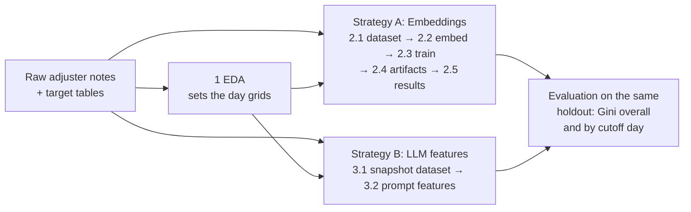
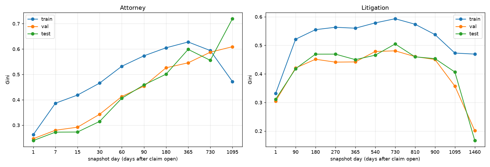
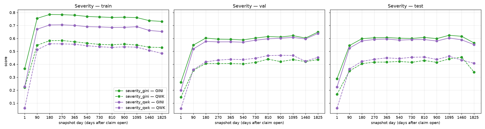

# Predicting Bodily Injury (BI) Severity, Litigation Risk & Attorney Involvement from Adjuster Notes

**Author:** Jay Jajoo · Northeastern University capstone (Fall 2026)
**Sponsor:** a New England auto insurer

---

## 1. The problem

When an auto accident causes an injury, the insurer has to judge early how expensive the claim will be and
whether it will turn into a lawsuit. Today that judgment comes from an adjuster reading free-text claim notes
by hand. This project predicts three outcomes **from the adjuster notes alone, as they stood on a given day**:

| # | Target | Question | Type | Source column |
|---|---|---|---|---|
| 1 | **Attorney** | Will the claimant hire a lawyer? | binary | `ATTNY_FLG` |
| 2 | **Litigation** | Will the claim become a lawsuit instead of a negotiated settlement? | binary | `LITIG_FLG` |
| 3 | **Severity** | Which cost band will the claim close in? `$0–2.5K`, `$2.5–10K`, `$10–25K`, `$25–100K`, `$100K+` | 5-class ordinal | `SEV_BUCKET` (0–4) |

Early, accurate flags let an insurer fast-track low-risk claims and send high-risk ones to legal review sooner.

**What this project adds.** Prior work uses either note embeddings (Fursov et al., 2019) or LLM-extracted
structure (Li et al., 2025) for insurance claims. This project compares **both strategies head-to-head with
the same snapshot rules, targets and split**, for attorney involvement, litigation and BI severity.

---

## 2. Data

| Item | Size |
|---|---|
| Adjuster notes (`BI_Notes`, 16 CSV batches) | **4,645,819 notes** across **138,233 claims** |
| BI coverages, claim years 2015–2022 (`BI-Coverage-ALL-2015_2022.parquet`) | 169,322 coverages (167,726 closed) |
| Endpoint tables (`Endpoint-Attorney`, `Endpoint-Litigation`, `Endpoint-Severity`) | one row per coverage (`CLM_CVG_PK`) |

- **Grain:** notes are keyed by claim (`CLAIM_NUM`); targets are keyed by coverage (`CLM_CVG_PK`). One claim can
  have several coverages (one per injured party), and they share the same notes.
- **Notes:** adjuster shorthand (`COVG`, `LIAB`, `RES`, `POA`, ...) mixed with free text and HTML. Median note is
  46 words, but a claim's full history is long (median 26 notes per claim, about 1.4 years from first to last note).
- **Base rates (coverage level):** attorney about 44%, litigation about 7%, severity buckets about
  60% / 16% / 12% / 8% / 3%.

---

## 3. Overall approach



Both strategies build their rows with the same snapshot rules (§3.1) and the same claim-level split
algorithm and seed (§3.2). Strategy A builds them in `2.1-DatasetDevelopment`, Strategy B in
`3.1-Dataset-Development.ipynb`.

### 3.1 Framing: predict at a point in time, never after the event

A model is only useful if it predicts *before* the attorney is hired, the suit is filed or the claim closes.
So every training row is a **snapshot**: the claim's notes as they stood on day *d* after the claim opened.

- **Day grids** (days after `CLM_OPEN_DT`), denser early because attorney involvement happens fast
  (median 31 days) and litigation slowly (median 666 days):
  - Attorney: `1, 7, 15, 30, 60, 90, 180, 365, 730, 1095`
  - Litigation: `1, 90, 180, 270, 365, 540, 730, 810, 900, 1095, 1460`
  - Severity: `1, 90, 180, 270, 365, 540, 730, 810, 900, 1095, 1460, 1825`
- **Boundary per coverage:** the event date if the event happened (`ATTNY_DT` / `LITIG_DT`), otherwise the
  coverage close date; for severity, `LAST_CLOSE_DT`. Snapshots stop once a cutoff reaches the boundary.
- **Leakage margin:** only notes strictly before the boundary are kept. If no note falls exactly on the
  boundary, the last kept note is also dropped **if it mentions the event** (keyword check, e.g. "LOR",
  "attorney", "summons", "settlement"), since the event date in the system often lags the note.
- Snapshots with no new notes, and snapshots with 0 notes, are skipped.

### 3.2 Train / validation / holdout split

One **global, claim-level, stratified 70/15/15 split**, shared by all three targets and both strategies.
Stratified on `ORG_GROUP_NAME` + `POL_STATE` + `LOSS_YEAR` + `ATTNY_FLG` + `LITIG_FLG` + `SEV_BUCKET`.
Splitting by claim (not by coverage or snapshot) keeps shared note text from leaking across splits.

| Split | Claims | Attorney rows | Litigation rows | Severity rows |
|---|---|---|---|---|
| train / val / holdout | 81,212 / 17,418 / 17,267 | 466,090 total | 388,956 total | 619,029 total |

### 3.3 Two feature strategies

| | **A. Note embeddings** (`2-EmbeddingBasedApproach/`) | **B. LLM-extracted features** (`3-ManualFeatureBasedApproach/`) |
|---|---|---|
| Idea | Embed each note once, then summarize the running history numerically | Have an LLM read the snapshot like a senior analyst and answer fixed questions |
| Model | `Alibaba-NLP/gte-Qwen2-1.5B-instruct` (1,536-dim) on SageMaker | Claude Opus 5.5 through the Claude Agent SDK, structured JSON output |
| Features | 8 summaries of the note embeddings at each cutoff (mean, max, min, sum, max÷min, max−min, first÷last, first−last) | 171 interpretable features (A01–A59 attorney, L01–L69 litigation, S01–S43 severity), each with an evidence quote |
| Downstream model | Multi-branch neural net (`CutoffNet`: one encoder per summary → fusion → MLP), tuned with Optuna; attorney, litigation and severity | To be trained on the extracted features (pilot stage) |
| Strengths | Cheap per note; scales to 4.65M notes | Interpretable, auditable features; domain-aware |

### 3.4 Evaluation

- **Primary metric: Gini = 2·AUC − 1**, the standard ranking metric in insurance. It is threshold-free and
  robust to class imbalance (litigation is about 7% positive), and it matches how the sponsor uses scores: to
  rank claims for triage.
- **Gini by cutoff day** on the holdout: shows how early a useful signal appears, which is the business question.
- **Row-level Gini** (every snapshot) and **last-snapshot Gini** (each coverage's latest snapshot).
- **Severity** (5 ordered bands): an **ordinal Gini** (the 4 cumulative "band ≥ k" Ginis, averaged with
  weights min(positives, negatives)) and **quadratic-weighted kappa (QWK)**, which checks that the predicted band
  itself is right and penalizes predictions that are further off more.
- **Holdout is used once**, for final reporting. Model selection uses validation only (Gini; QWK for the
  QWK-selected severity model).
- For strategy B, also: **schema validity** (every value checked exactly against its allowed list),
  **run-to-run stability** (share of identical values across two runs), and **cost per snapshot**.

---

## 4. Results so far

**Strategy A, embeddings** (`2-EmbeddingBasedApproach/2.5-Results/2.5.1-Results-Visualization.ipynb`):

| Study | Best trial | Val Gini | Holdout Gini (all snapshots) | Holdout Gini (last snapshot) | Holdout QWK |
|---|---|---|---|---|---|
| Attorney | 42 | 0.334 | 0.326 | 0.407 | – |
| Litigation | 24 | 0.479 | 0.488 | 0.697 | – |
| Severity, selected on Gini | 32 | 0.563 | 0.569 | 0.752 | 0.402 |
| Severity, selected on QWK | 23 | 0.425 (QWK) | 0.546 | 0.730 | 0.430 |

**Holdout Gini by snapshot day:**

| Snapshot day | Attorney | Litigation | Severity (Gini-selected) | Severity (QWK-selected) |
|---|---|---|---|---|
| 1 | 0.239 | 0.311 | 0.289 | 0.225 |
| 7 | 0.272 | – | – | – |
| 15 | 0.273 | – | – | – |
| 30 | 0.315 | – | – | – |
| 60 | 0.406 | – | – | – |
| 90 | 0.459 | 0.418 | 0.545 | 0.525 |
| 180 | 0.501 | 0.469 | 0.598 | 0.580 |
| 270 | – | 0.469 | 0.605 | 0.592 |
| 365 | 0.599 | 0.450 | 0.607 | 0.596 |
| 540 | – | 0.466 | 0.602 | 0.587 |
| 730 | 0.556 | 0.505 | 0.600 | 0.591 |
| 810 | – | 0.460 | 0.608 | 0.592 |
| 900 | – | 0.454 | 0.599 | 0.580 |
| 1,095 | 0.719 | 0.407 | 0.624 | 0.604 |
| 1,460 | – | 0.167 | 0.616 | 0.589 |
| 1,825 | – | – | 0.565 | 0.552 |





Day = days after the claim opened (`CLM_OPEN_DT + day`); "–" means that day is not on that target's grid. Each
row scores only the coverages still open and event-free on that day, using the notes written before it. Small
late-day groups are noisy, for example attorney day 1,095 with 43 positives or litigation day 1,460 with 16.

- The signal grows as the claim develops. Attorney goes from 0.24 on day 1 to 0.60 by day 365, and severity from
  0.29 to 0.55 by day 90.
- Severity is the strongest model. Selecting on QWK gives up a little ranking (Gini 0.546 vs 0.569) for better
  band agreement (QWK 0.430 vs 0.402).
- Litigation is the strongest binary model (test Gini 0.488 on all rows, 0.697 at the last snapshot).
- Attorney is the weakest: most of its rows fall in the first 30 days, when few notes exist.
- Validation and holdout agree within 0.01 for every study.

Row and event counts per day are in `2-EmbeddingBasedApproach/README.md`. The results notebook in
`2-EmbeddingBasedApproach/2.5-Results/` also has the severity confusion matrices by cutoff day and decile tables by
cutoff day (with a day slider) for all four models, including the severity Gini at each band threshold.

**Strategy B, LLM features (100-snapshot pilot from train):** 100 of 100 snapshots returned valid outputs on
the first try. Two independent runs agreed on **97.8%** of all feature values (none of the 171 features below
90%). Cost was **$0.34 per snapshot** ($34 for 100).

---

## 5. Repository layout

```
.
├── README.md                          ← this file
├── config.py                          ← all paths and storage settings (edit before running)
├── requirements.txt                   ← Python dependencies
├── .gitignore                         ← keeps confidential data and outputs out of git
├── 1-EDA_Cleaned.ipynb                ← exploratory data analysis (sets the day grids)
├── 2-EmbeddingBasedApproach/          ← Strategy A: note embeddings → neural net
│   ├── README.md
│   ├── 2.1-DatasetDevelopment/        ← 2.1.1 keyword registry, 2.1.2 global split, 2.1.3 cutoff datasets
│   ├── 2.2-Embedding/                 ← 2.2.1 note preparation, 2.2.2 embedding inference (notebooks)
│   ├── 2.3-ModelTraining/             ← 2.3.1 SageMaker launcher, 2.3.2 Optuna tuning, CutoffNet + training loop
│   ├── 2.4-ModelArtifacts/            ← best checkpoint per study + dataset / split / study manifests
│   └── 2.5-Results/                   ← 2.5.1 results notebook (Gini by day, confusion, decile tables), figures
└── 3-ManualFeatureBasedApproach/      ← Strategy B: LLM-extracted features
    ├── README.md
    ├── 3.1-Dataset-Development.ipynb  ← leakage-safe snapshot datasets (note text) + global split
    └── 3.2-PromptFeatures.ipynb       ← 100-snapshot feature-extraction pilot
```

### Notebooks

**`1-EDA_Cleaned.ipynb`: exploratory data analysis**
- Two worked example claims (one with attorney and litigation), printed note by note with a plain-English
  walkthrough, to show what the notes contain and where the attorney and litigation dates fall.
- Corpus-wide statistics over all 4.65M notes: words and characters per note, notes per claim, claim duration,
  gaps between notes, note volume per year, top words and a word cloud.
- Target analysis: attorney and litigation rate and severity mix by claim-open year, by severity bucket, by
  `ORG_GROUP_NAME` (Direct vs. Independent) and by loss state.
- Time to event: days from claim open to attorney, to litigation and to close. These results set the day grids
  used in `3.1-Dataset-Development`.

**`3-ManualFeatureBasedApproach/3.1-Dataset-Development.ipynb`: snapshot dataset construction (Strategy B)**
- Starts with high-level pseudocode, then implements the rules in §3.1: per-model boundaries, keyword-checked margin rule, day grids, dedup and 0-note skip.
- Unit check of the margin rule, a test on the EDA sample claim and on 12 edge cases (sibling coverages with
  different outcomes, long attorney and litigation lags, events that never happened).
- Global claim-level stratified split (§3.2).
- Full build: caches all notes once, then runs the three models in parallel processes and writes parquet batches
  to `{SNAPSHOT_PREFIX}/{Attorney|Litigation|Severity}/{train|val|holdout}/`.
- Output schema: `CLM_CVG_PK, CLM_NUM, SNAPSHOT_NUM, SNAPSHOT_DAY, N_NOTES, NOTE_TEXT, TARGET` (or
  `TARGET_BUCKET` for severity).

---

## 6. How to reproduce

**Run order:** `1-EDA_Cleaned` (optional), then either strategy; the two are independent.
- **Strategy A** (`2-EmbeddingBasedApproach/`, one folder per step): `2.1-DatasetDevelopment/2.1.1-build_keyword_registry.py`
  → `2.1.2-assign_global_splits.py` → `2.2-Embedding/2.2.1` → `2.2.2` → `2.1-DatasetDevelopment/2.1.3-build_cutoff_dataset.py` →
  `2.3-ModelTraining/2.3.1-launch_sagemaker.py` (once per study) → `2.5-Results/2.5.1-Results-Visualization.ipynb`.
- **Strategy B** (`3-ManualFeatureBasedApproach/`): `3.1-Dataset-Development.ipynb` → `3.2-PromptFeatures.ipynb`
  (which reads 3.1's snapshot rows).

**Environment**
- Python 3.12; `pandas`, `numpy`, `pyarrow`, `matplotlib`, `wordcloud`, `boto3`, `scikit-learn`
- Strategy A: `torch`, `optuna`, `orjson`, `sagemaker` (SDK v2 for the `2.2.2` endpoint, SDK v3 `ModelTrainer` for
  `2.3.1-launch_sagemaker.py`). The endpoint pins `transformers==4.51.3` and `sentence-transformers==5.7.0`
- Strategy B: `claude-agent-sdk==0.2.180` and a logged-in Claude Code install
- Compute used: `3.1-Dataset-Development` on a 16-core, 54 GB RAM machine (about 15 min for all three models); `2.2.2` on 4 × `ml.g5.xlarge`
  (budget cap $100); tuning on one `ml.g5.4xlarge` per study (2.3 to 5.8 h per study)

**Before running:** edit **`config.py`** (the only file with paths): local data folders, S3 bucket and prefixes,
AWS region and SageMaker role ARN. Every notebook and script imports its paths from it. Install packages with
`pip install -r requirements.txt`.

**Determinism:** all sampling and splitting uses `seed=42` (`numpy.random.default_rng`, `torch.manual_seed`).

---

## 7. Attribution

All code, dataset design, prompts and analysis in this repository are my own work. External components are
used as tools and are credited here:

- Embedding model: `Alibaba-NLP/gte-Qwen2-1.5B-instruct` (Hugging Face), served with the AWS Hugging Face DLC.
- Feature extraction: Claude Opus 5.5 (Anthropic) through the Claude Agent SDK.
- Libraries: pandas, NumPy, PyTorch, Optuna, scikit-learn, sentence-transformers, boto3, SageMaker SDK.

**References**
- Fursov, I. et al. (2019). *Sequence embeddings help to identify fraudulent cases in healthcare insurance.* arXiv:1910.03072.
- Li, et al. (2025). Textual analysis of insurance claims with large language models. *Journal of Risk and Insurance*, 92, 505–537.
